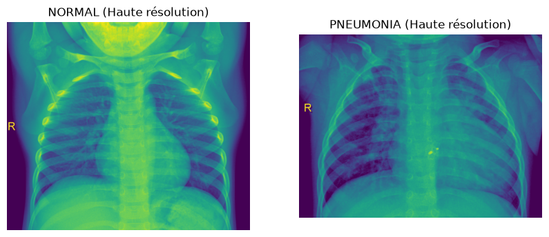
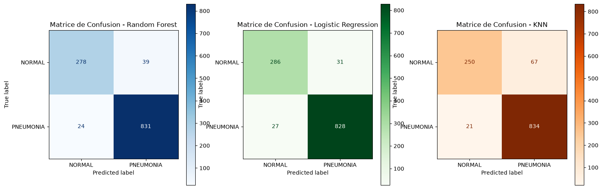
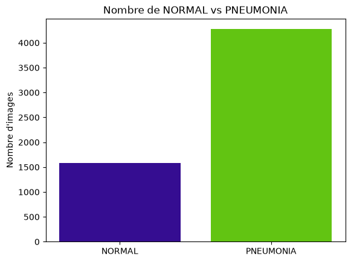
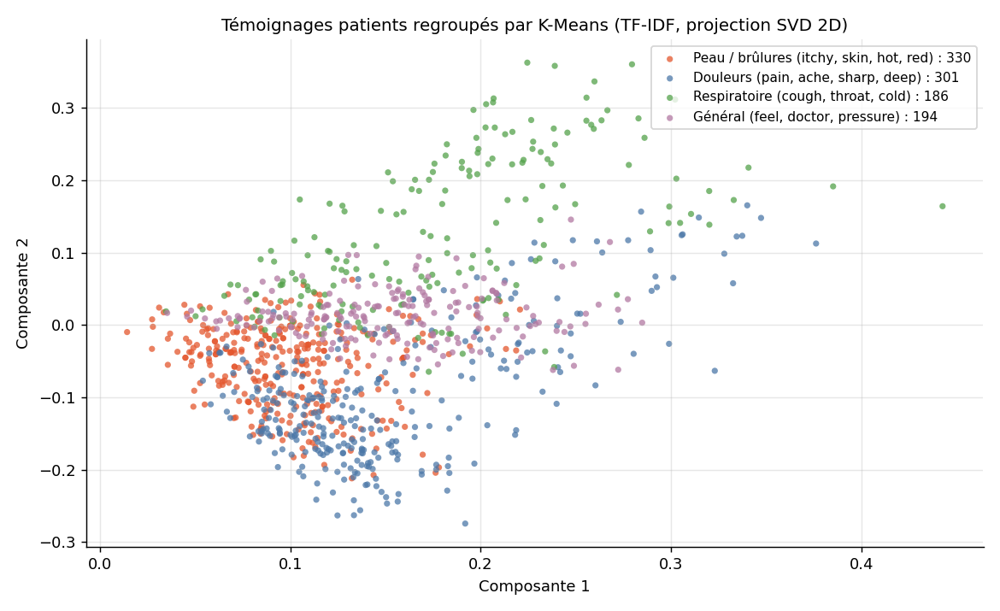

<h1 align="center">🩺 CVRIE : IA médicale pour la radiologie et l'analyse de témoignages patients</h1>

<p align="center">
  Projet de <b>Machine Learning</b> en deux volets : détection de pneumonie sur radiographies pulmonaires (apprentissage supervisé)
  et regroupement automatique de témoignages patients par symptômes (apprentissage non supervisé, NLP).
</p>

<p align="center">
  
  
  
  
  
  
</p>

<p align="center">
  
</p>

---

## Sommaire

- [En bref](#en-bref)
- [Résultats clés](#résultats-clés)
- [1. Détection de pneumonie (supervisé)](#1-détection-de-pneumonie-supervisé)
- [2. Regroupement des témoignages patients (non supervisé)](#2-regroupement-des-témoignages-patients-non-supervisé)
- [Installation et lancement](#installation-et-lancement)
- [Structure du dépôt](#structure-du-dépôt)
- [Limites et pistes d'amélioration](#limites-et-pistes-damélioration)
- [Équipe](#équipe)

## En bref

Projet réalisé en binôme dans le cadre du cursus **Epitech** (module B-SPE-311). Mise en situation : aider les équipes d'un hôpital sur deux tâches.

| Volet | Données | Objectif | Approche |
| :--- | :--- | :--- | :--- |
| **Supervisé** | 5 856 radiographies thoraciques pédiatriques | Classer chaque radio en `NORMAL` ou `PNEUMONIA` | Random Forest, Régression logistique, KNN |
| **Non supervisé** | 1 011 témoignages patients en texte libre, sans étiquette | Regrouper les témoignages par type de symptômes | TF-IDF, K-Means, clustering hiérarchique |

## Résultats clés

**Détection de pneumonie**, sur un jeu de test de 1 172 radiographies (855 pneumonies, 317 normales) :

| Modèle | Accuracy | Pneumonies détectées | Pneumonies manquées | Fausses alertes |
| :--- | :--- | :--- | :--- | :--- |
| **Random Forest** (retenu) | 94.6 % | 831 / 855 (97.2 %) | 24 | 39 |
| Régression logistique | **95.1 %** | 828 / 855 (96.8 %) | 27 | **31** |
| KNN (k = 5) | 92.5 % | **834 / 855 (97.5 %)** | **21** | 67 |

<p align="center">
  
</p>

Dans un contexte médical, **manquer une pneumonie coûte plus cher qu'une fausse alerte** : l'accuracy seule ne suffit pas à choisir.
Les trois modèles sont proches. Le **Random Forest** est retenu comme compromis : il manque 3 pneumonies de moins que la régression logistique
(pour 8 fausses alertes de plus), et déclenche 28 fausses alertes de moins que le KNN (pour 3 pneumonies manquées de plus).

**Regroupement des témoignages** : 4 groupes cohérents se dégagent automatiquement, sans aucune étiquette.

| Groupe | Mots-clés dominants | Témoignages |
| :--- | :--- | :--- |
| Peau et brûlures | itchy, skin, hot, red | 330 |
| Douleurs | pain, ache, sharp, deep | 301 |
| Symptômes généraux | feel, doctor, pressure | 194 |
| Respiratoire | cough, throat, cold, mild | 186 |

## 1. Détection de pneumonie (supervisé)

Notebook : [`notebooks/supervise_analysis.ipynb`](notebooks/supervise_analysis.ipynb)

**Préparation des images**
- Chargement des 5 856 radiographies (dossiers `train`, `test` et `val` regroupés) avec gestion d'erreurs
- Conversion en niveaux de gris et redimensionnement en 64 × 64 pixels
- Aplatissement en vecteurs de 4 096 valeurs, normalisées entre 0 et 1
- Découpage entraînement / test 80 % / 20 % **stratifié**, car les classes sont déséquilibrées (1 583 normales contre 4 273 pneumonies)

<p align="center">
  
</p>

**Modèles comparés**
- **Random Forest** : combine de nombreux arbres de décision et capture des relations non linéaires entre pixels (critère d'impureté de Gini).
- **Régression logistique** : modèle linéaire rapide et interprétable, optimisé par la log-loss (entropie croisée).
- **KNN** : classe chaque image selon ses 5 plus proches voisines.

Chaque modèle est évalué par l'accuracy, la précision, le rappel, le F1-score et la matrice de confusion, avec une attention particulière aux **faux négatifs** (pneumonies manquées).

## 2. Regroupement des témoignages patients (non supervisé)

Notebook : [`notebooks/non_supervise_analysis.ipynb`](notebooks/non_supervise_analysis.ipynb)

- **Lecture robuste d'un CSV irrégulier** : la colonne de couleur n'est pas présente sur toutes les lignes, un parseur dédié remet les colonnes en ordre.
- **Vectorisation TF-IDF** des témoignages (en anglais), en filtrant les mots vides (*stop words*).
- **K-Means à 4 groupes**, puis projection en 2 dimensions avec `TruncatedSVD`, adaptée aux matrices creuses produites par TF-IDF.
- **Évaluation sans vérité terrain** avec le score de silhouette, et comparaison avec un clustering hiérarchique (K-Means : 0.0104, hiérarchique : 0.0086).
- **Interprétation** : extraction des 5 mots les plus représentatifs de chaque groupe pour leur donner un sens médical.

<p align="center">
  
</p>

Le score de silhouette, proche de 0, montre que les groupes se chevauchent : les témoignages sont courts et partagent beaucoup de vocabulaire.
Les mots-clés de chaque groupe restent néanmoins cohérents et exploitables pour un premier tri.

## Installation et lancement

**Prérequis** : Python 3.12 ou plus récent.

```bash
git clone https://github.com/klasken/Cvrie.git
cd Cvrie
python3 -m venv venv
source venv/bin/activate          # Windows : venv\Scripts\activate
pip install -r requirements.txt
```

**Données** : elles ne sont pas versionnées (dossier `data/` ignoré par Git).

- **Radiographies** : télécharger le jeu [Chest X-Ray Images (Pneumonia)](https://www.kaggle.com/datasets/paultimothymooney/chest-xray-pneumonia) sur Kaggle et le placer dans `data/chest_xray/`, avec les sous-dossiers `train/`, `test/` et `val/`, chacun contenant `NORMAL/` et `PNEUMONIA/`.
- **Témoignages patients** : le fichier `data/Student_Dataset.csv` a été fourni par Epitech et n'est pas redistribué.

**Lancer les notebooks** (depuis le dossier `notebooks/`, les chemins vers `../data` sont relatifs) :

```bash
cd notebooks
jupyter lab
```

Le dossier `src/` contient le point d'entrée en ligne de commande demandé par le sujet : il vérifie l'accès au jeu de données et renvoie le code d'erreur `84` en cas de problème.

```bash
python3 src/main.py data/Student_Dataset.csv
```

## Structure du dépôt

| Chemin | Description |
| :--- | :--- |
| `notebooks/supervise_analysis.ipynb` | Détection de pneumonie : préparation des images, comparaison des 3 modèles, matrices de confusion |
| `notebooks/non_supervise_analysis.ipynb` | Témoignages patients : parsing, TF-IDF, K-Means, silhouette, interprétation des groupes |
| `src/main.py` | Point d'entrée en ligne de commande (vérification des données, code de sortie 84) |
| `bonus/` | Résumé du projet et benchmark des modèles |
| `docs/` | Images du README |
| `requirements.txt` | Dépendances Python |

## Limites et pistes d'amélioration

- **Découpage par image et non par patient** : un même patient peut avoir plusieurs radiographies, qui peuvent se retrouver à la fois dans l'entraînement et dans le test. Les scores sont donc probablement un peu optimistes ; un découpage par patient serait plus rigoureux.
- **Pixels bruts en 64 × 64** : un réseau de neurones convolutif (CNN), ou un modèle pré-entraîné en *transfer learning*, exploiterait bien mieux la structure des images.
- **Réduire encore les pneumonies manquées** : ajuster le seuil de décision ou pondérer les classes (`class_weight`) pour privilégier le rappel sur la classe `PNEUMONIA`.
- **Clustering** : choisir le nombre de groupes avec la méthode du coude ou la silhouette, et tester des représentations sémantiques (embeddings de phrases) à la place de TF-IDF.

## Équipe

Projet réalisé en binôme à Epitech par :

- **Marius Ceugniet** ([@klasken](https://github.com/klasken)), principalement sur la détection de pneumonie
- **Sacha Bouron**, principalement sur l'analyse des témoignages et le benchmark

---

<sub>Radiographies : D. Kermany, K. Zhang et M. Goldbaum (2018), <i>Chest X-Ray Images (Pediatric Pneumonia)</i>, Mendeley Data, licence CC BY 4.0, version Kaggle publiée par Paul Mooney.</sub>
